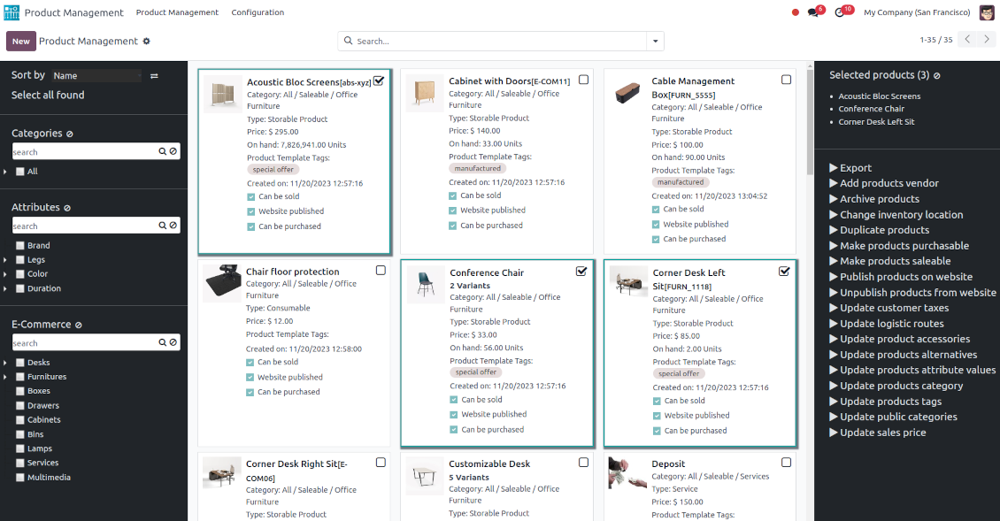
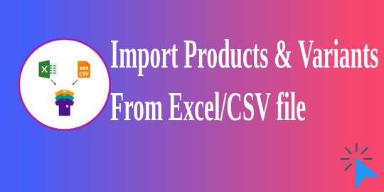
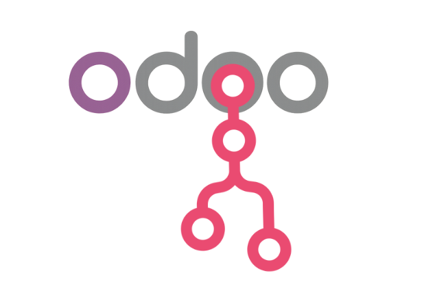

# ODOOPIM — AI-Powered Product Information Management Suite for Odoo 18

  

An enterprise-grade **Product Information Management (PIM)** suite built on Odoo 18, delivering **Akeneo PIM–style** capabilities — families, attributes, channelization, localization, approval workflows, AI enrichment & translation, marketplace connectors, and an embedded AI chatbot — all natively integrated with Odoo Sales, Inventory, Website and Studio.

> Part of the ODOOPIM product line (onboarder.odoopim.com). Built as a production platform with 25 inter-connected custom modules.

---

## Repository Structure

```
odoopim-ai-suite/
├── pim_ext/                    # Core PIM application (families, categories, attributes, brands)
├── product_management/         # Product data management & mass actions
├── product_info_management/    # Product information management
├── pim_product_creation/       # Guided product creation flows
├── pim_channelization/         # Channel-based attribute field mapping
├── pim_localization/           # Localize product attribute fields
├── pim_locales_channels/       # Combined locales + channels management
├── pim_approval_workflow/      # Product approval workflows
├── pim_attribute_validations/  # Validation rules on attributes
├── odoo_pim_association/       # Akeneo-style product associations (accessories, cross-sell...)
├── odoo_pim_connector/         # n8n + marketplace/platform connectors (Shopify, Magento, Amazon...)
├── import_product_variants_app/# Excel/CSV bulk import of products & variants with images
├── ai_bot_odoopim/             # Embedded AI chatbot (document loader, xlsx support)
├── ai_enrichment/              # AI provider/model management for enrichment
├── pim_ai_transulate/          # AI translation of attributes
├── pim_website/                # PXM shop snippets & website fields
├── supabind_dashboard/         # Embedded onboarder dashboard (iframe app)
├── concurrent_user_restriction/# Concurrent login restriction
├── web_char_capitalize/        # Auto-capitalize char fields
├── odoo_deletedialog/          # Delete confirmation dialog
├── control_panel/              # PIM control panel (jsTree powered)
├── category_hierarchy_widget/  # Category hierarchy widget
├── odoopim_split_widget/       # Attribute split view widget
├── oi_fields_attribute/        # Attribute field widgets
└── sh_product_custom_fields/   # Custom product fields (3rd-party base, customized)
```

## Highlights

- **Core PIM engine** — product families, attribute groups, categories (hierarchy), brands, suppliers, mass edit wizards, publish actions.
- **Channelization + Localization** — model attribute values per sales channel and locale (Akeneo-inspired), with a combined locales/channels manager.
- **AI layer** — provider/model registry, AI-driven attribute enrichment, AI attribute translation, and an in-web-client AI chatbot with document loading and xlsx export.
- **Integrations** — n8n connector image export; connectors for Shopify/Amazon/Magento/eBay/Flipkart/Shopware/Walmart/Sellercloud/B2B.
- **Approval workflow** — configurable approval states before product publication.
- **Bulk operations** — Excel/CSV import of products & variants (with attributes + images + custom fields), plus mass actions, export configs and category/tags/vendor/accessory updaters.
- **UX widgets** — split views, category hierarchy, image drag-and-drop, progress bars, embedded many2one forms, one2many list/kanban switchers, custom color/boolean widgets.

## Screenshots

| Overview | Import & Variants |
|---|---|
|  |  |

| Marketplace Connectors | n8n Connector |
|---|---|
|  |  |

## Dependencies

`web, base, sale, product, stock, website_sale, web_hierarchy, mail, web_studio, stock_barcode, spreadsheet_dashboard`

## License

LGPL-3 (as declared in module manifests).
